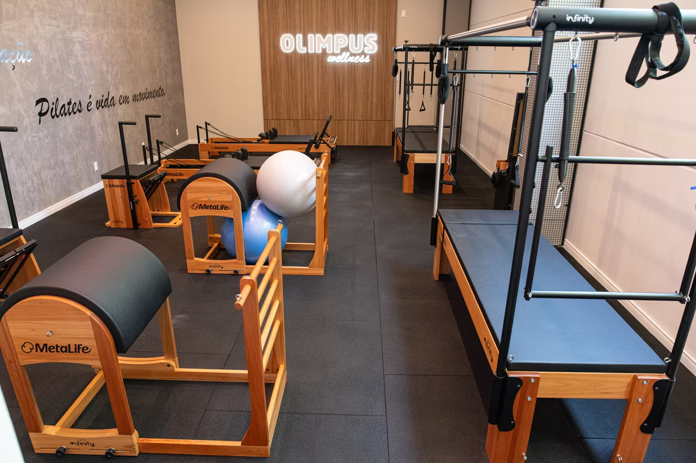

# 🏋️‍♂️ Olimpus Group — Complexo Esportivo

Landing page institucional e promocional desenvolvida para o **Olimpus Group Complexo Esportivo**, localizado em Chapecó - SC. O projeto apresenta toda a estrutura, modalidades, comodidades, horários e planos da academia, contando com recursos interativos e integração direta com o WhatsApp para captação de alunos e agendamento de aulas experimentais.

---

## ✨ Funcionalidades do Projeto

* **Status de Funcionamento em Tempo Real:** Barra superior inteligente que verifica o dia da semana e o horário atual do dispositivo para exibir automaticamente se o complexo está **"ABERTO AGORA"** ou **"FECHADO AGORA"**, destacando o dia correspondente na tabela de horários.
* **Filtro Dinâmico de Modalidades e Planos:** Abas interativas em JavaScript puro com transições suaves para filtrar modalidades (*Musculação, CrossFit, Pilates, Beach Tennis, Conveniência*) e categorias de planos.
* **Quiz "Descubra Seu Plano Ideal":** Recomendador interativo em modal que sugere o plano mais adequado com base na faixa etária e no objetivo do usuário.
* **Integração Direta com WhatsApp:**
  * Modal de adesão rápida para cada um dos 6 planos.
  * Formulário completo de **Aula Experimental / Cadastro Prévio** com máscara dinâmica de telefone, validação de campos e envio de mensagem formatada para a recepção.
* **Contadores Animados:** Estatísticas do complexo animadas sob demanda quando entram na área visível da tela (`IntersectionObserver`).
* **Design Responsivo & Identidade Visual:** Layout totalmente adaptável para celulares, tablets e desktops, estilizado com paleta de cores sólidas institucionais (`#730202` e `#FFBC05`).

---

## 🛠️ Tecnologias Utilizadas

O projeto foi construído utilizando tecnologias web padrão e bibliotecas carregadas via CDN (sem necessidade de *build* ou instalação de pacotes Node.js):

* **HTML5** — Estruturação semântica e acessível.
* **CSS3 (`styles.css`)** — Estilizações customizadas, barra de rolagem personalizada, efeito *glassmorphism* no cabeçalho e animações de transição.
* **Tailwind CSS (via CDN) + `tailwind-config.js`** — Estilização utilitária e configuração de cores, fontes e sombras personalizadas.
* **JavaScript Vanilla (`script.js`)** — Manipulação de DOM, filtros, modais, validação de formulários e cálculo de horário comercial.
* **Google Fonts** — Tipografias *Oswald* (títulos esportivos) e *Inter* (leitura fluida).
* **Font Awesome 6** — Ícones vetoriais.

---

## 📂 Estrutura de Pastas e Arquivos

```text
site_academia/
├── imagens/
│   ├── armarios.png       # Imagem local da estrutura de armários
│   └── pilates.png        # Imagem local do Studio de Pilates
├── index.html             # Página principal com todas as seções e modais
├── styles.css             # Estilos complementares e animações CSS
├── tailwind-config.js     # Configuração de tema e cores do Tailwind CSS
├── script.js              # Lógica interativa da página em JavaScript puro
└── README.md              # Documentação do projeto
```

---

## 🚀 Como Executar o Projeto

Por ser um projeto estático front-end que consome o Tailwind CSS, Font Awesome e Google Fonts via CDN, **você precisa estar conectado à internet** na primeira abertura para que os estilos e ícones carreguem corretamente.

### Pré-requisitos

* Um navegador web moderno (Google Chrome, Edge, Firefox, Safari ou Brave).
* *(Opcional)* Editor de código **Visual Studio Code (VS Code)**.

---

### Opção 1: Abrir diretamente no navegador (Mais rápido)

1. Caso tenha baixado o projeto compactado (`.zip`), extraia todo o conteúdo para uma pasta no seu computador.
2. Acesse a pasta extraída do projeto.
3. Dê um **duplo clique** sobre o arquivo **`index.html`** (ou clique com o botão direito nele e selecione *Abrir com > Google Chrome*).

---

### Opção 2: Executar com VS Code + Live Server (Recomendado para desenvolvimento)

Se você pretende editar textos, códigos ou trocar imagens na pasta `imagens/`, este método atualiza a página automaticamente a cada alteração salva:

1. Abra o **Visual Studio Code**.
2. Vá em **Arquivo > Abrir Pasta...** (`File > Open Folder...`) e selecione a pasta do projeto.
3. Na aba de **Extensões** (`Ctrl+Shift+X`), pesquise por **Live Server** (de *Ritwick Dey*) e clique em **Instalar**.
4. Clique com o botão direito sobre o arquivo `index.html` no explorador do VS Code e selecione **"Open with Live Server"** (ou clique em **"Go Live"** no canto inferior direito do VS Code).
5. O site será aberto automaticamente em `http://127.0.0.1:5500`.

---

### Opção 3: Executar via Terminal (Python ou Node.js)

Caso prefira subir um servidor HTTP local via linha de comando na pasta raiz do projeto:

* **Com Python 3 instalado:**
  ```bash
  python -m http.server 8000
  ```
  Depois, acesse `http://localhost:8000` no navegador.

* **Com Node.js instalado:**
  ```bash
  npx serve .
  ```
  Depois, acesse o endereço exibido no terminal (geralmente `http://localhost:3000`).

---

## 🖼️ Como Adicionar ou Substituir Imagens Locais

1. Salve a sua nova imagem (`.png`, `.jpg` ou `.webp`) dentro da pasta **`imagens/`**.
2. No arquivo `index.html`, referencie o arquivo usando o caminho relativo:
   ```html
   
   ```
3. Caso queira alterar a imagem de fundo do banner principal no arquivo `styles.css`, atualize a classe `.hero-bg`:
   ```css
   .hero-bg {
       background: url('imagens/sua-imagem.png') center/cover no-repeat;
       box-shadow: inset 0 0 0 2000px rgba(10, 10, 12, 0.88);
   }
   ```

---

## 📍 Informações de Contato Configuradas

* **Endereço:** Rua Curitiba, 701 - Bairro Santa Maria, Chapecó - SC, CEP 89812-353
* **WhatsApp de Destino dos Formulários:** `(49) 98411-4896` (configurável na constante `WHATSAPP_NUMBER` na linha 1 do arquivo `script.js`)
* **Instagram:** [@groupolimpus](https://www.instagram.com/groupolimpus)